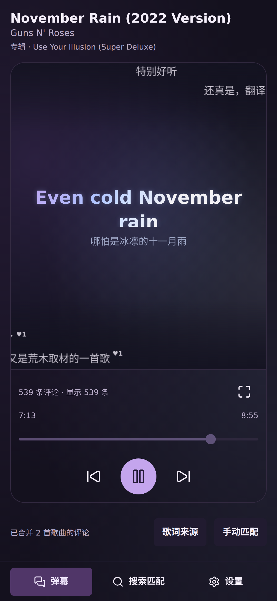
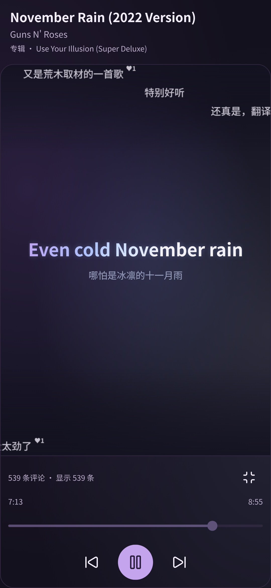
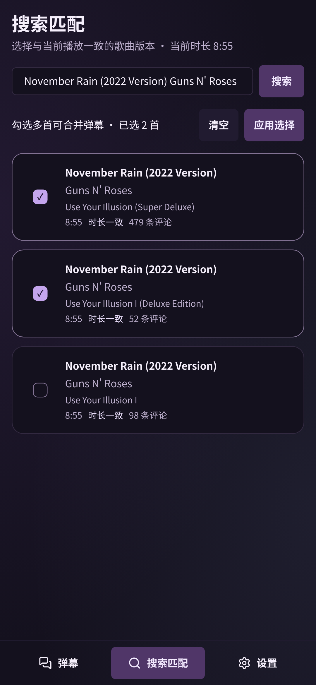

# MusicDan

让热评，跟着音乐走。MusicDan 把网易云音乐评论变成弹幕，让你在喜欢的音乐 App 里，也能看见同一首歌的共鸣。

<p align="center">
  <br/>
</p>

## 本地音乐，在线评论

不用换播放器。MusicDan 自动识别正在播放的歌曲，匹配网易云音乐版本，把散落在评论区的文字带到你眼前——可以在应用内看，也可以悬浮在**任何音乐 App**上面。

### 弹幕，浮在音乐之上

- 悬浮在其他音乐 App 上层：透明、触摸穿透，看歌词、切歌都不挡操作
- 退到后台自动显示，回到前台自动隐藏；通知栏可直接暂停或关闭
- 自动避让系统栏、铺满可用空间；轨道数量与穿屏速度随屏幕和评论量自动调整，允许同轨重叠
- 热评优先，上千条评论跟随播放进度滚动，实时显示评论总数与播放进度
- 支持反向控制原音乐 App：播放/暂停、上一首/下一首、拖动进度条都能在 MusicDan 里完成

<p align="center">
  
</p>

### 歌词与全屏弹幕

- 同步显示网易云音乐歌词，翻译行排版清晰，支持双语对照
- 当前行以渐变墨迹高亮并加大字号，前后歌词柔和退后，阅读聚焦
- 歌词背景带氛围渐变与边缘光效，与整体视觉统一
- 上下滑动浏览歌词，选中任意一行即可从那里定位播放（需音乐 App 支持进度控制）
- 一键全屏，弹幕与歌词铺满整块屏幕，可设置全屏时保持屏幕常亮

<p align="center">
  
</p>

### 同一首歌，不止一个版本

- 自动匹配不准时，手动搜索网易云歌曲版本；「时长一致」标记帮助确认版本
- 勾选多首合并弹幕：原唱、现场、翻唱的评论一起看，发现更多听众的故事
- 手动匹配会被记住，随时可恢复自动匹配
- 字号、不透明度、显示上限随时调整，改动即时生效，无需重新抓取

| 搜索匹配 | 弹幕外观 |
| --- | --- |
|  |  |

### 评论加载与合并

- 后台全量抓取歌曲全部评论并本地缓存，热评优先，每新增 1000 条增量合并
- 相似评论自动合并为一组（重复次数越多字号越大），一组只占一条弹幕、按赞数选优
- 每分钟检查评论增长，超过阈值（默认 10%）才重新抓取，其余时间直接读缓存

## 下载

- 官网 [musicdan.syncmoon.ink](https://musicdan.syncmoon.ink) 与 [GitHub Releases](https://github.com/asinkLuno/MusicDan/releases) 提供相同的发布安装包，每个版本附 SHA-256 校验值
- 需要 **Android 7.0（API 24）及以上**；仅提供 arm64-v8a（64 位）安装包，暂不支持 32 位 armv7 或 x86 / x86_64 模拟器

安装后开启弹幕：

1. 首次安装时，按系统提示允许从浏览器安装应用。
2. 打开 MusicDan，在设置中授予**通知使用权**，用于识别音乐 App 当前播放的歌曲。
3. 想在其他音乐 App 上看弹幕，再授予**显示在其他应用上层**权限，并开启悬浮弹幕，随后回到播放器播放歌曲即可。

注意事项：

- 主动关闭悬浮服务或进程被终止后，需要在设置中重新开启悬浮弹幕
- 部分系统页面及主动屏蔽悬浮窗的 App 会隐藏悬浮层
- Android 13 及以上若关闭了应用通知，前台服务通知可能不显示，可在系统的应用通知设置中开启

## 开发

```sh
yarn                                # 安装依赖（本项目只用 yarn，不要用 npm/pnpm）
yarn dev                            # 浏览器预览界面；媒体功能需要安卓真机
yarn build                          # TypeScript 检查及前端构建
yarn test                           # 弹幕容量、跳转和去重测试
yarn tauri android dev              # 真机调试
yarn tauri android build --debug --target aarch64 --apk
cd src-tauri && cargo test --lib    # Rust 侧测试
```

安卓构建需要 JDK、Android SDK / NDK 和对应的 Rust target，并设置 `ANDROID_HOME`、`NDK_HOME`。项目包含已定制的 `src-tauri/gen/android`，不要重新初始化覆盖其中的系统栏适配。

---

MusicDan · 让喜欢的歌，多一点共鸣。
