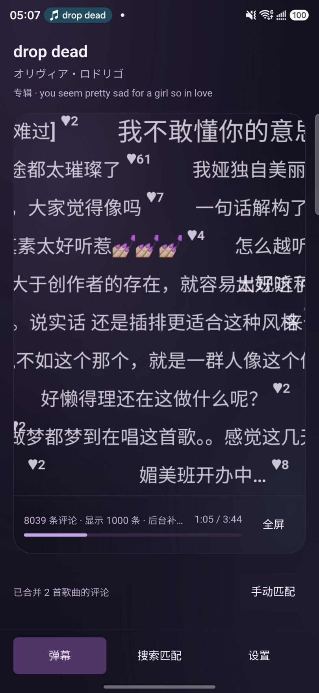
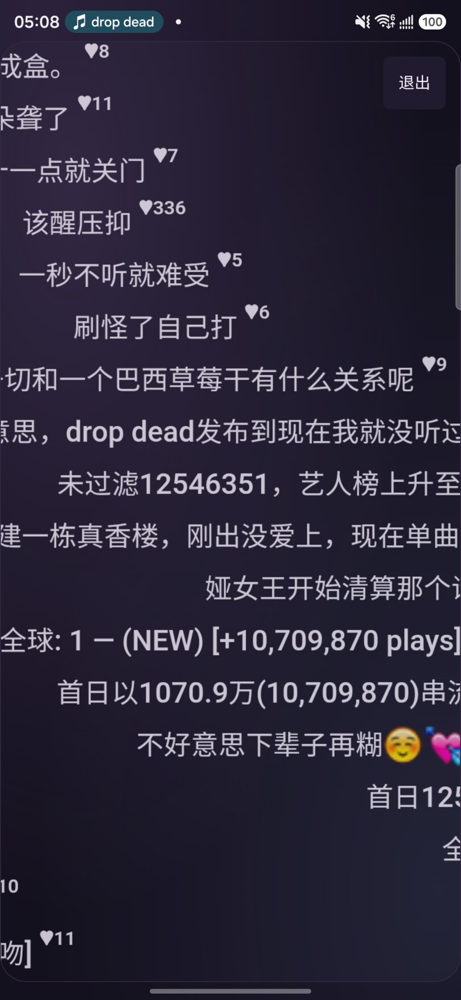
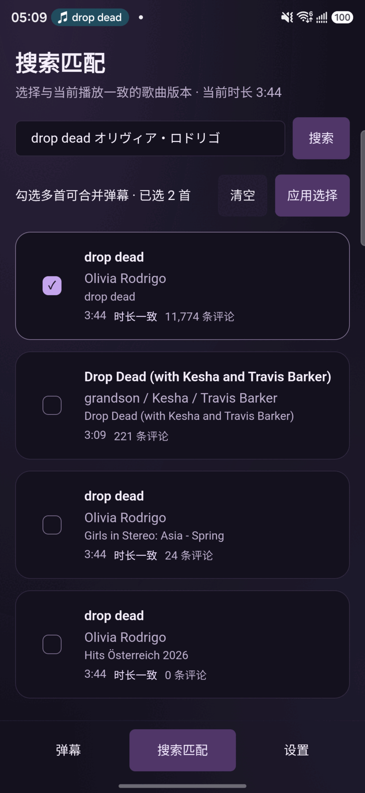
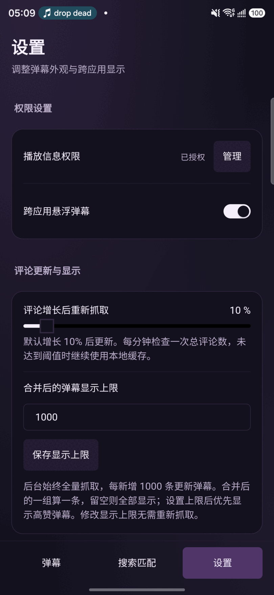
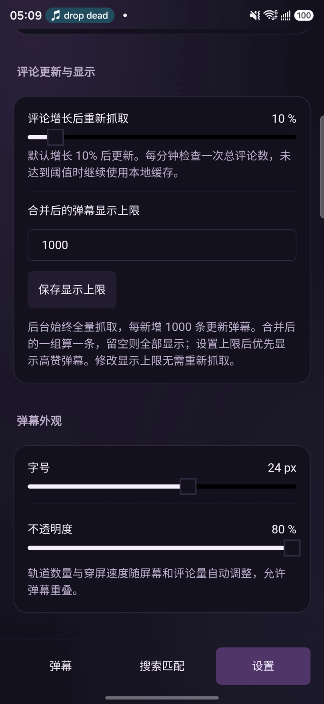

# MusicDan

读取手机上正在播放的音乐，自动匹配网易云音乐版本，把热评变成跟着歌曲走的弹幕 —— 可以在应用内看，也可以悬浮在**任何音乐 App**上面。

<p align="center">
  <br/>
</p>

## 功能

### 跨应用悬浮弹幕

- 悬浮在其他音乐 App 上层：透明、触摸穿透，看歌词、切歌都不挡操作
- 退到后台自动显示，回到前台自动隐藏；通知栏可直接暂停或关闭
- 自动避让系统栏、铺满可用空间；轨道数量与穿屏速度随屏幕和评论量自动调整，允许同轨重叠

### 应用内弹幕

- 自动识别当前播放歌曲，热评优先展示，按播放进度同步滚动
- 一键全屏；实时显示评论总数、显示条数与播放进度

| 应用内弹幕 | 全屏弹幕 |
| --- | --- |
|  |  |

### 搜索匹配

- 自动匹配不准时，手动搜索网易云歌曲版本；「时长一致」标记帮助确认版本
- 勾选多首合并弹幕：原唱、现场、翻唱的评论一起看
- 手动匹配会被记住，随时可恢复自动匹配

<p align="center">
  
</p>

### 评论加载与合并

- 后台全量抓取歌曲全部评论并本地缓存，热评优先，每新增 1000 条增量合并
- 相似评论自动合并为一组（重复次数越多字号越大），一组只占一条弹幕、按赞数选优
- 每分钟检查评论增长，超过阈值（默认 10%）才重新抓取，其余时间直接读缓存

### 弹幕外观

- 字号、不透明度、显示上限随时可调，改动即时生效，无需重新抓取

| 权限与评论设置 | 弹幕外观 |
| --- | --- |
|  |  |

## 权限说明

- **通知使用权**：用于读取音乐 App 的媒体会话（正在播放什么、播到哪了）
- **显示在其他应用上层**：跨应用悬浮弹幕必需
- 主动关闭悬浮服务或进程被终止后，需要在设置中重新开启悬浮弹幕
- 部分系统页面及主动屏蔽悬浮窗的 App 会隐藏悬浮层
- Android 13 及以上若关闭了应用通知，前台服务通知可能不显示，可在系统的应用通知设置中开启

## 开发

```sh
yarn                                # 安装依赖（本项目只用 yarn，不要用 npm/pnpm）
yarn dev                            # 浏览器预览界面；媒体功能需要安卓真机
yarn build                          # TypeScript 检查及前端构建
yarn test                           # 弹幕容量、跳转和去重测试
yarn tauri android dev              # 真机调试
yarn tauri android build --debug --target aarch64 --apk
cd src-tauri && cargo test --lib    # Rust 侧测试
```

安卓构建需要 JDK、Android SDK / NDK 和对应的 Rust target，并设置 `ANDROID_HOME`、`NDK_HOME`。项目包含已定制的 `src-tauri/gen/android`，不要重新初始化覆盖其中的系统栏适配。

## 文档

- [Native 系统设计](docs/native-system-design.md) —— 原生层目录、职责、数据流与生命周期
- [表情渲染](docs/emote-rendering-guide.md)
