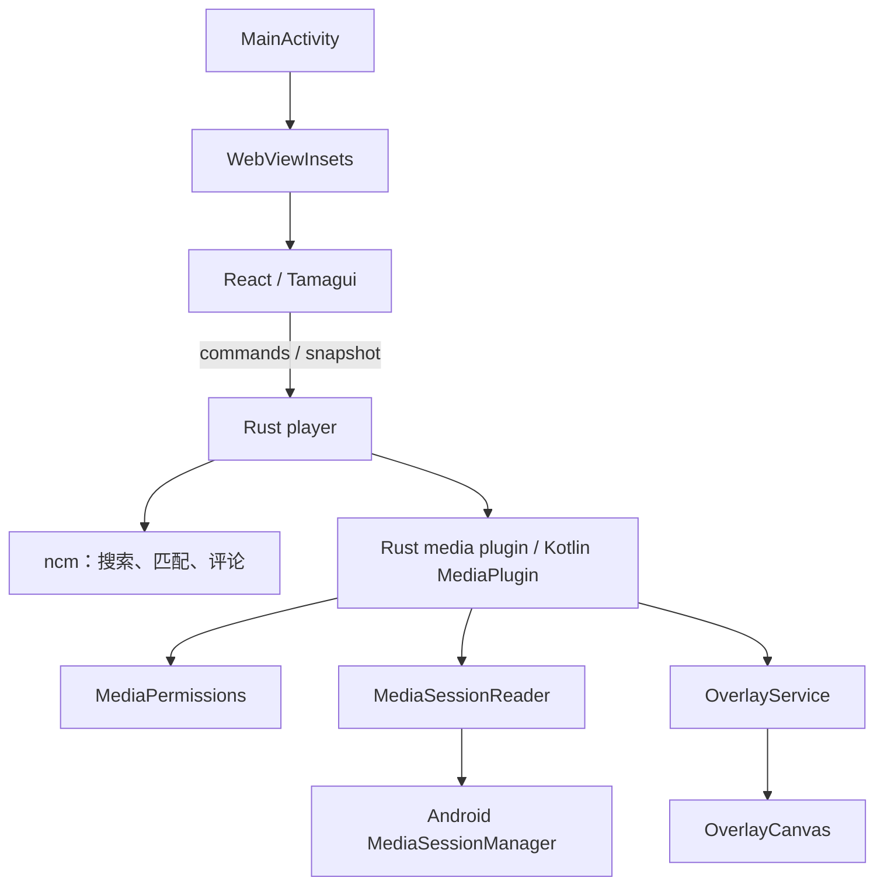

# Native 系统设计

## 范围与分层

MusicDan 的 native 由 Rust 应用核心和 Android 平台适配组成。Rust 持有播放快照、歌曲匹配、评论与设置；Android 读取系统媒体会话、管理权限和悬浮窗口。WebView 消费快照并提供操作入口。



## 文件布局与职责

```text
src-tauri/src/
  lib.rs                          应用装配、命令注册
  player.rs                       快照、轮询、设置持久化、匹配调度
  ncm.rs + ncm/                   音乐服务访问与文本处理
plugins/tauri-plugin-media/
  src/
    lib.rs                        插件装配
    commands.rs                   Tauri 命令入口
    models.rs                     Rust 序列化契约
    mobile.rs / desktop.rs        平台分发
  android/src/main/java/com/musicdan/media/
    MediaPlugin.kt                Kotlin 命令适配、错误转换、Activity 生命周期
    MediaListenerService.kt       系统通知使用权组件
    OverlayService.kt             前台服务、通知、WindowManager、显示生命周期
    permission/MediaPermissions.kt 通知使用权查询
    session/MediaSessionReader.kt 系统会话选择、元数据投影、进度采样
    overlay/OverlayCanvas.kt      弹幕筛选、轨道调度、Canvas 绘制
src-tauri/gen/android/app/src/main/java/ink/starmountain/musicdan/
  MainActivity.kt                 Activity 入口与系统栏外观
  window/WebViewInsets.kt         安全边距注入、DPR 换算、页面重载支持
```

目录与 Kotlin package 对齐。Android 注册组件和 Tauri 插件入口保留原有完整类名 `com.musicdan.media.MediaPlugin`、`MediaListenerService`、`OverlayService`；尤其通知监听服务的组件身份必须稳定，以保留已有授权。`gen/android` 包含项目维护的 Activity 和构建定制，不应重新初始化覆盖；生成的 TauriActivity 等文件不承担业务逻辑。

## 数据流与契约

1. Rust `player` 启动轮询，通过插件读取 Android 会话；每轮完成后休眠一秒。
2. `MediaPlugin` 在单线程执行器中调用 `MediaSessionReader`，优先选正在播放的会话，否则选第一个。权限检查从系统实时读取，不缓存授权。
3. `NowPlaying` 使用 camelCase，包含歌曲、毫秒进度、时长、速度、播放状态、来源包名与系统进度采样时间。Android 先把会话进度外推至本次读取时刻。
4. Rust 用歌名、歌手、专辑构成 track key。切歌时递增 generation；异步匹配结果仅在 generation 仍相同时写回，避免旧请求覆盖新歌。
5. `Snapshot` 包含 `permissionGranted`、`sampledAt`、`nowPlaying`、`song`、`comments`、`loading`、`error`、`revision`、`settings` 和 `manualMatch`。评论内容变化通过 revision 通知渲染器重建缓存。
6. WebView 每轮完成后等待 750ms 再读取快照；Rust 同时把快照交给 `updateOverlay`。原生绘制不依赖 WebView 的动画循环。

跨语言 JSON 字段改动必须同步检查 `models.rs`、Rust Snapshot、`src/types.ts` 与 Kotlin 的读取逻辑。Canvas 颜色必须使用实际色值，不能传入 CSS 变量。

## 状态、线程和生命周期

- Rust `Player` 的 `Arc<Mutex<Inner>>` 是应用内状态源；网络请求在锁外执行，只有读写共享状态时持锁。设置与手动匹配使用临时文件写入后 rename。
- Kotlin bridge 将 Binder 会话读取放到工作线程；Service 与 View 的窗口操作由 Android 生命周期和插件 UI 调用路径触发。新增异步调用方时必须切回主线程后操作窗口。
- `OverlayService` 持有窗口、通知、暂停状态；`OverlayCanvas` 只持有最近一帧及绘制缓存。Service 的 latestFrame/instance 为进程内交接点，不是持久化状态。
- 前台服务创建前检查悬浮权限，成功挂载窗口后发布 instance；销毁时移除窗口并清理 instance。返回 `START_NOT_STICKY`，用户停止或进程终止后不自动恢复。
- 应用可见或通知暂停时隐藏悬浮层；切到其他应用后显示。通知提供继续/暂停、关闭和返回应用入口。
- 窗口不可聚焦、不可触摸；不透明度受设置和系统触摸遮挡阈值共同限制。
- 原生渲染根据收到帧时的 uptime 与 playbackSpeed 插值；仅在播放且窗口可见时继续请求动画帧。WebView 使用独立 PlaybackClock 处理快照采样、跳转和暂停。

## 权限与失败处理

通知使用权用于读取 MediaSession，悬浮窗权限用于 WindowManager；二者分别检查和授权。通知权限声明用于服务通知，不等同于上述两项授权。

未授权时返回 permissionGranted=false；读取会话遇到 SecurityException 同样返回未授权并携带错误。窗口创建失败记录日志并停止服务。搜索或评论请求失败写入快照 error，由界面提供重试入口。

## 验证与后续边界

本次调整拆分 Kotlin 职责并整理包目录，保留命令名、JSON 契约、服务组件名与调度行为。验证包括 ARM64 Debug 完整构建、现有前端测试和真机启动检查。

仍需人工覆盖的场景：授权后返回、撤销授权、跨应用悬浮、通知暂停/继续/关闭、分屏与旋转、切歌和拖动进度。原生渲染与 TypeScript 调度目前分别实现，未来修改算法时需对照相同输入验证轨道和容量。若继续扩展，可优先抽出纯 Kotlin 调度器并增加 JVM 测试，再考虑替换进程内 service 引用为显式状态通道。
